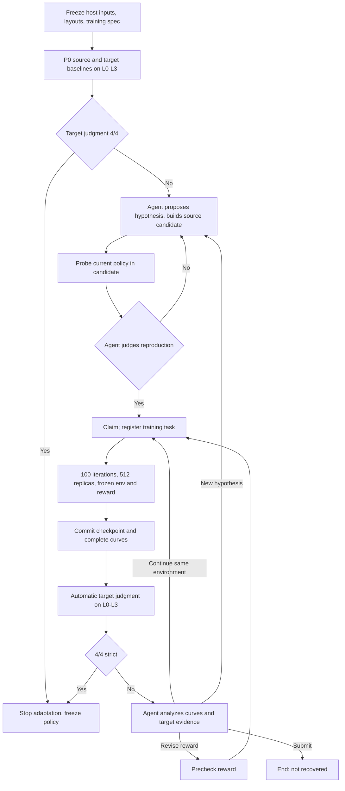

# DynamicsAdapt: a Policy-Driven Harness for Environment Diagnosis and Adaptation

Research design and protocol. Revised 2026-11-11 from the original draft (commit
`40e14a5`) with the user's decisions of the same day. The engineering specification,
milestones and acceptance tests are in [docs/HARNESS_SPEC.md](docs/HARNESS_SPEC.md).
Development boundaries are in [AGENTS.md](AGENTS.md). Nothing in this document has
been implemented yet unless §11 says it was measured.

## 1. Research question and core idea

Can an Agent infer missing or inaccurate source dynamics from an existing policy's
behavior in a target environment, reproduce those differences in a revised source
simulator, and recover target task performance by continuing reinforcement learning
in that source?

The long-term direction is sim-to-real; this implementation is sim-to-sim.
Cube-to-plate is the first task adapter. The harness is general: its orchestration
layer must not assume cube-to-plate observations, parameters or scoring.

**Core idea.** The host provides a policy P0 that is approximately optimal for the
task in the source simulator and whose performance drops in the target. The Agent
watches this policy act, identifies what the source simulator gets wrong, revises
the simulator, and resumes training from the current policy rather than retraining
from scratch. The policy is the Agent's interaction interface: the Agent requests
experiments, the policy executes every robot action, and the resulting trajectories
are the Agent's evidence. Continued PPO training in a revised source both adapts the
policy and keeps this interface competent at the task.

The Agent's main research product is a sequence of source simulator versions
`E1 → E2 → …`. It may discover properties and laws absent from the initial source
model: adjust parameters, add laws acting on existing state, add state variables and
degrees of freedom, revise geometry/contact structure, or replace dynamics modules.
Adapters provide integration capability; they do not enumerate admissible
hypotheses. An interface's inability to express a hypothesis is an engineering gap
(`capability_unavailable`), not evidence against the hypothesis.

| Object | Research role | Process role |
|---|---|---|
| Source dynamics model `E_i` | Main object the Agent revises | Built from Agent candidates, versioned with reasons for change |
| Policy | Learnable probing and task-execution interface | Executes all formal robot actions; source and target trajectories inform modeling |
| PPO | Improves the interface in an accepted, frozen source | Continues the latest complete training state; only source data enter gradients |

## 2. Confirmed settings

| Item | Setting |
|---|---|
| Host inputs | P0, the initial source, the fixed target, the task adapter, layout tables, and the training specification |
| P0 (cube-to-plate) | The deployable policy (DP): 21-dim actor (clock, commanded pad, one-shot detected cube/plate, opening), 54-dim asymmetric critic. Artifact `runs/202611101817_dp_a2_train/policy_it000.pt`, calibration `runs/202611091633_dp_calibrate3/calibration.json`, spec [DEPLOYABLE_POLICY_SPEC.md](docs/DEPLOYABLE_POLICY_SPEC.md) |
| Target | Fixed by the host, hidden from the Agent. First case (cube-to-plate): a single friction reduction, with mass, restitution and gripper nominal. P0 fails outright on it (§11). Values live only in host-private configuration (§9) |
| Agent observations of the target | Raw video, proprioception, executed commands, finger tactile sensor responses (no object identity), strict/lenient outcomes and execution status |
| Source information for the Agent | Source model description, editable interfaces and source ground truth (for modeling, analysis and rewards) |
| Environment modifications | Parameters, added laws, added states/DOFs, geometry/contact revisions, new or replacement dynamics modules |
| Reproduction judgment | The Agent's; the host checks only that cited evidence exists and matches versions |
| Policy lineage | Linear. Every training task continues the latest complete policy, both Adam optimizers and counters. No branching from older policies |
| Action mode | Source training samples stochastically over all five action dimensions. Baselines, probes, target validation, source progress evaluation and final evaluation use policy mean actions |
| Training | BC removed. Each `train` registers one task of 100 iterations; each iteration runs one complete episode in each of 512 parallel replicas of the one candidate environment |
| Training task completion | 100 iterations executed. No reward-plateau or source-performance stopping |
| Target judgment | 4 episodes, one on each of four host-frozen layouts L0–L3 (§5). Adaptation succeeds when all 4 are strict successes |
| Experiment end | Judgment success, Agent submission, Agent exit without submission, or host cancellation (§6.3). No research budgets on rounds, tasks, duration, probes or deploys; all usage is recorded |
| Final evaluation | Freeze the selected policy; 30 deterministic target episodes on 30 held-out layouts F0–F29, run for P0 and the selected policy. Pass marker 27/30 strict |
| Source performance | Not a success criterion. Source curves are recorded for analysis only |
| Agent model | Astra (`gpt-6-astra`), reasoning effort high, via the Codex CLI preset |
| Hardware | One RTX 4090 shared by simulation, policy inference, GAE and PPO; training has no rendering |

Preserved cube-to-plate contract: five-action decoder, 25 Hz control, 300-step
horizon, native scoring, strict/lenient definitions, termination order, and
`gripper_scale = 1.0`.

## 3. Information boundaries

| Data | Source | Target |
|---|---|---|
| Raw RGB video | Exported for probes | Exported for baselines and judgment/deploy batches |
| Timestamps, joint positions/velocities, gripper opening | Exported | Exported |
| Executed actions, end-effector commands, grip-force commands | Exported | Exported |
| End-effector position | Forward kinematics from proprioception | Same |
| Finger tactile response (all colliding objects in the sensing region, no identities) | Exported | Exported |
| Object poses/velocities, true contact relationships | Source ground-truth files | Host-private |
| Strict/lenient outcome and execution status | Exported | Exported |
| Ground-truth-derived metrics (slip, lift height, release distance, failure subtype) | Available | Host-private |
| Policy inputs (actor/critic) | In source training records | Host-private |

Target data are for observation, diagnosis and validation only. They never become
PPO transitions, demonstrations, normalization-statistics updates or any gradient
input. These boundaries restrict exported fields; they do not remove information
conveyed by behavior (for example, episode length hints at failure type). Reports
disclose this rather than altering termination.

## 4. Host preparation (outside the Agent harness)

The experiments evaluate the harness, not the host-provided materials. The host is
responsible for supplying a meaningful case; the user has verified that the first
case's target is recoverable, so no recoverability check is part of this plan. The
remaining host checks only confirm that P0 and the target behave as expected on the
formal backend and layouts. Their
outputs and costs are host-private, reported separately, and never enter the Agent
workspace.

| Step | Purpose | Requirement |
|---|---|---|
| H0 Backend acceptance | The 512-replica GPU backend reproduces the accepted P0 behavior | HARNESS_SPEC M0/M3 gates; see §11 for current measurements |
| H1 P0 source check | P0 works on the formal layouts in the formal source backend | Report strict outcomes on L0–L3 and F0–F29 in the nominal source (no threshold on training performance, but a P0 that fails in the source is not a valid case) |
| H2 Target construction | The gap must matter | P0 fails outright in the target: 0/4 strict on L0–L3 preferred; report F0–F29. Parameter changes may be combined to reach this |
Recoverability of the target is the host's responsibility and was verified by the
user for the first case; it is not re-run. A domain-randomization reference is
deferred.

## 5. Layouts and episode streams

All layout tables are generated from host seeds, frozen at experiment start, and
identical for every policy and repetition of a case. Cube-to-plate layouts are drawn
from the DP layout distribution (cube ±3 cm, plate box x ∈ [0, 3] cm,
y ∈ [−3, 0] cm), so P0 was trained on this distribution.

| Use | Layouts | Episodes |
|---|---|---|
| Baselines, probes, target judgment and `deploy` | L0–L3 (fixed) | One deterministic episode per layout; a probe may request any nonempty subset |
| Source training | Fresh layout per training episode from the DP distribution, seeded by `(experiment, task, iteration, replica)` | 512 per iteration |
| Source progress evaluation | 512 fixed evaluation layouts | Iterations 0, 10, …, 100 of each task |
| Final evaluation | F0–F29 (held out from L0–L3 and training seeds) | 30 deterministic episodes per evaluated policy |

Seed streams for layouts, detection noise, action sampling and PPO minibatches are
separate and independent of worker scheduling and batch position.

## 6. Agent loop

### 6.1 Requests

`status`, `build` (freeze a candidate environment), `probe` (current policy in a
built source, mean actions, chosen subset of L0–L3), `deploy` (registered policy in
the target, 4 judgment episodes), `reproduce` (immutable claim citing source and
target evidence for the current policy), `train` (register a 100-iteration task),
`wait`, `submit`. Request details are in HARNESS_SPEC §4.

### 6.2 State flow

- Each training task freezes environment, reward and training specification and
  always runs its 100 iterations. Finishing a task establishes neither optimality nor
  that the environment is wrong. The Agent decides what to do next.
- A claim made at the start of an environment round authorizes further tasks for
  descendants of its entry policy in the same environment without new probes.
  A new environment requires a new probe and claim with the latest policy.
- Changing environment never resets the policy, optimizers or global counters.
- The first training task of the experiment, and the first task after a reward
  code change, train only the critic for its first 2 iterations (counted in the 100).
- Every target access is retained; no best-batch reporting.

### 6.3 Ending an experiment

| End state | Trigger |
|---|---|
| `recovered` | P0 baseline or any complete standard judgment batch is 4/4 strict |
| `submitted_not_recovered` | The Agent calls `submit` without recovery |
| `agent_exited` | The Agent session ends without `submit` after the relaunch policy (§10) is exhausted |
| `host_cancelled` | Operator stop or confirmed infrastructure failure; a censored observation |

The Agent owns the stopping decision; there are no research budgets. After
`recovered`, a live session may enter a diagnosis-only wrap-up (existing evidence and
`submit` only). Final evaluation runs only after the experiment ends and is never
returned to the Agent. Missing diagnoses are recorded as missing.

## 7. Experiments, metrics and analysis

### 7.1 Experiments and repetitions

One experiment is one Agent session from frozen host inputs to an end state. The
Agent decides how many environments, probes, deploys and training tasks to use.
Repetitions are independent experiments on the same case with a fresh Agent session
and workspace (the model is stochastic); they are not limits on training calls. The
first case runs one experiment (user decision 2026-11-11). One experiment is one
observation; it shows whether recovery is possible, not a recovery rate.

### 7.2 Primary and secondary measures

- Recovery: end state, judgment history, final evaluation (strict and lenient) for P0
  and the selected policy.
- Target interaction cost: target episodes to recovery (baseline, judgments,
  deploys), counted per experiment. This is the scarce resource in sim-to-real.
- Source cost: training rollouts and actual transitions (summed episode lengths),
  probe and evaluation episodes, training tasks, wall time and GPU time.
- Agent cost: wall time, model calls and tokens, relaunches.
- Diagnosis quality (§7.4) and reproduction fidelity (§7.5).

### 7.3 Learning curves and sample efficiency

Per iteration, retain per-episode returns, lengths and strict/lenient outcomes,
distribution statistics, cumulative rollouts and transitions, warm-up flags, timing
and versions. Independent source evaluation at iterations 0, 10, …, 100 (mean
actions, 512 fixed evaluation layouts, separate random streams, no effect on
training state) adds 5,632 episodes per task. Training-sample returns (pre-update
policy) and evaluation returns (post-update checkpoint) are labeled separately.

Post hoc analysis rules:

1. Freeze metrics and thresholds before formal comparisons; thresholds chosen after
   viewing curves are exploratory.
2. A threshold crossing is the earliest evaluated checkpoint that reaches it; with
   10-iteration spacing this is not the true first crossing.
3. Compare costs by actual transitions first, rollouts second.
4. Report "not reached within the recorded tasks" rather than extrapolating.
5. Different reward programs and source environments are not directly comparable;
   successors in a lineage carry earlier training.
6. Report task-local, cumulative adaptation, diagnostic/evaluation and P0
   preparation costs separately.
7. Target recovery is measured only at judgment points; do not infer target success
   from source curves.

### 7.4 Diagnosis scoring (post hoc, host-only)

The runtime host validates diagnosis structure only. After the experiment ends, the
host scores the submitted diagnosis against the hidden target specification:

- Mechanism identification: whether the stated primary mechanism matches the host
  modification (category and affected object/interaction).
- Parameter or law estimate error, where the diagnosis gives one.
- Evidence quality: whether cited jobs support the claims; whether competing
  explanations were tested.

Scores use a rubric frozen before the first formal experiment, are stored with host
records, and are never returned to an Agent.

### 7.5 Reproduction fidelity (post hoc, host-only)

For each built environment that entered training, the host runs P0 and the policy at
the round's entry in that environment and in the target on L0–L3 and compares, using
ground truth on both sides: strict/lenient outcome agreement, cube trajectory error,
contact-sequence agreement and episode-length difference. This measures how much of
the sim-to-sim gap each revision closed, independent of task recovery. Runs are
host-private and counted separately from Agent costs.

## 8. Training semantics (summary)

One iteration resets 512 isolated replicas, runs one complete episode each (at most
300 control steps; no second episode after early termination), computes the Agent
reward in the isolated runner, GAE along each replica's valid timeline and PPO
updates on GPU, and saves model, both optimizers, `log_std`, counters, random states
and versions. One task is at most 51,200 episodes and 15,360,000 transitions plus
5,632 evaluation episodes and 4 judgment episodes. PPO keeps the existing learning
rates, 8 epochs, gamma, GAE lambda, clipping and KL settings, with minibatch 8,192;
the 64× larger batch is a recorded change. Normal episode ends (success, task
failure, native termination, horizon) keep zero bootstrap; execution failures are
not `done` transitions. Details are in HARNESS_SPEC §6.

## 9. Information leakage controls

- The target specification exists only in host-private configuration outside Git
  (`local/` or the run's host directory). Tracked files, examples and documentation do
  not name formal target values.
- The Agent container mounts only its workspace and the request socket. It never
  sees the repository, its documentation, Git history, other runs, host-preparation
  results (H1–H2), oracle rewards or earlier experiments' workspaces.
- The Agent CLI home is staged fresh per experiment with only the credential and model
  routing (`orchestrator/launch_agent.py:stage_home`); no host memories,
  transcripts, instructions or MCP servers.
- Workspace instructions say only that P0 behaves differently in the source and
  target. They name no physical factor, candidate parameter list or range.
- `source_reference/` is generated from an allowlist of source-model files; hidden
  target implementations, credentials and host records are excluded.
- Target logs, errors, metrics and paths pass the same public-output filter as
  trajectories; error messages must not reveal private configuration.
- Repetitions of a case start from empty workspaces; nothing carries over.

## 10. Agent runtime management

Modeled on EmbodiedEvo (`orchestrator/agent_recovery.py`) and RAX
(`robodojo-behavior/container`, docs/USAGE.md §3):

- Lifecycle record `agent-lifecycle.json`: status (`preparing`, `running`,
  `waiting_job`, `exited`, `stopped`, `failed`), every launch, relaunch and error.
- Host jobs are independent of the Agent process. Training tasks keep running when
  the Agent is relaunched; `wait` and `status` reconnect to them.
- Resume continues the same conversation (`codex exec resume`) in the same workspace
  with a fixed prompt: reread `notes/PROGRESS.md`, call `status`, and do not repeat a
  request whose response was lost (request IDs deduplicate side effects).
- Automatic relaunch in headless runs: an ended turn without `submit` is prompted to
  continue up to 3 times per launch; a transport/provider failure resumes after 300 s,
  up to 5 consecutive failures (a run of 30 minutes resets the count). Exhaustion ends
  the experiment as `agent_exited`.
- The workspace instructions require the Agent to keep `notes/PROGRESS.md` current
  (hypotheses, environments, claims, pending jobs, next step).
- Model calls and token usage are accumulated across launches; the requested model
  ID and reasoning effort are recorded.

## 11. Feasibility findings

M0 spike, 2026-11-11, one RTX 4090, simulator image as deployed (Isaac Lab 2.3.2).
Runs are under `runs/202611110150_*`, `runs/2026111102*_probe_*` and
`runs/*_probe_isaaclab_scale`; probe code is not kept in the repository.

| Check | Result |
|---|---|
| Current backend reference (CPU PhysX, one env per process, 2 processes), P0 on DP dev stream 37 | 20/20 strict, 20/20 lenient (matches the DP acceptance); 5,500 steps in 472 s ≈ 11.7 env-steps/s |
| GPU memory of the current per-process path | 3–8 GB per simulator process even with CPU PhysX (renderer, CuRobo); five concurrent processes exhausted 24 GB |
| GPU PhysX through the vendored RoboDojo environment (N=1) | Fails at reset: `env/reward_manager/func_parser.py:45` applies `np.concatenate` to CUDA tensors. About 200 NumPy conversions in `env/` and `src/eval_client/` assume CPU tensors; `vendor/` is read-only |
| Several envs in one RoboDojo process (CPU PhysX) | Native supports `num_envs > 1` (requires one seed per env), but the wrapper, scoring and contact monitor are env-0 specific and the native step loop stops or spins once a replica ends. Not a usable intermediate |
| Isaac Lab physics only (RoboDojo `dual_x5` scene config, kinematic table, 0.35 kg cube, GPU PhysX, 10 substeps per control step, no rendering, IK or scoring) | N=4: 22.5 ms per control step; N=64: 25.0 ms (2,557 env-steps/s); N=512: 25.9 ms (≈19,800 env-steps/s), 9.7 GB device memory including Kit and CuRobo, 59 s scene build. Cubes rest stably. No grasp contacts, so this is an upper bound |
| Existing single-goal CuRobo IK call | ≈11 ms per call (fixed-size CUDA graph; measured on unreachable targets). Per-env IK at N=512 would cost ≈5.7 s per control step |
| H2 preview: P0 in the target, current backend, dev stream 37 | 0/20 strict, 0/20 lenient; 18 dropped, 2 no lift; mean max clearance 14 mm |

Consequences:

1. The legacy architecture (one CPU-PhysX RoboDojo process per episode,
   ≈12 env-steps/s) cannot run the protocol: one 100-iteration task (≤15.36 M
   transitions) would take about 15 days there. This figure describes the legacy
   backend only and is the reason it is replaced; it is not a schedule for the
   experiment.
2. 512 GPU replicas are physically feasible on one 4090 with memory to spare for PPO.
3. The batch backend must be a new Isaac Lab implementation of the cube-to-plate
   scene that reuses RoboDojo assets and robot/scene configuration, not a wrapper
   around RoboDojo's environment managers.
4. IK must be batched (one solve for all replicas) or replaced by a GPU IK whose
   behavior is checked against the CuRobo path in the M3 parity gate.
5. Probes, judgments and final evaluation must move to the new backend (N=1 with
   rendering) so source and target share the physics backend. The CPU results above
   are the reference for the M3 parity gate and the H1/H2 re-checks.
6. Rough estimate, to be measured in M3: physics ≈26 ms plus batched IK and policy
   inference per control step gives a few thousand to ≈10,000 env-steps/s, that is
   about 0.5–2 hours of sampling per task. The M3 throughput gate (≥2,000
   env-steps/s at N=512) bounds a worst-case full task at ≈2.1 hours of sampling; a
   backend that cannot meet it does not pass M3 and is not used for the experiment.

## 12. Disclosures

Report: sim-to-sim only; one task adapter; the target is a host-chosen modification
of the same simulator; layouts are drawn from the P0 training distribution; the
backend change from per-process CPU PhysX to batched GPU PhysX (including the failed M3a target-parity gate and the target reselected on the new backend); simulated detection
in source training versus image detection in the target; asymmetric critic with
source ground truth; indirect information in episode length; repeated target access
without a budget; the number of repetitions; and every failed or partial attempt.

## 13. Decisions of 2026-11-11

| Question | Decision |
|---|---|
| Source training layouts | Fresh layout per training episode from the DP layout distribution |
| Final evaluation | 30 deterministic episodes on held-out layouts F0–F29 |
| Repetitions | One experiment for the first case |
| Target and host checks | Single friction-reduction target only. Recoverability was verified by the user and is not re-checked; domain randomization deferred |
| IK in the batch backend | GPU differential IK (Isaac Lab, damped least squares) batched over all replicas; it must pass the M3 controller and task parity gates against the CuRobo CPU reference. If parity fails, stop and consult the user |
| Throughput gate | At least 2,000 env-steps/s at N=512 with contacts, IK, policy inference and evidence retention; below that, stop and consult the user |
| M3a target parity (gate 3 failed, 2026-11-11) | The new GPU backend is accepted as the formal physics for source and target alike. On it, P0 in the original target scored 14/20 strict (CPU reference 0/20); the same new scene on CPU PhysX scored 1/20 strict, 11/20 lenient, so both GPU-vs-CPU PhysX and scene reconstruction contribute. Source and controller parity passed. H2 is redone on the new backend: the host-private target is reselected so that P0 fails outright on L0–L3. Disclosed in §12 |
