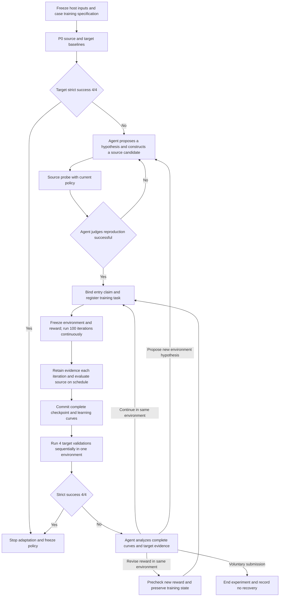

# A General Policy-Driven Harness for Environment Diagnosis and Adaptation

## 1. Objectives and Confirmed Research Settings

This document records the research specification and implementation plan, including migration and acceptance requirements based on the current experimental repository. This revision edits only the root `PLAN.md`; repository code is unchanged. The new harness functionality and acceptance checks described here have not yet been implemented or executed.

The research question is whether an Agent can infer missing or inaccurate source dynamics from an existing policy's behavior in a target environment, reproduce those differences in source simulation, and recover target task performance through reinforcement learning in the source environment.

The long-term direction is sim-to-real; this implementation is sim-to-sim. Cube-to-plate is the first task adapter. Its task details must not become fixed assumptions in the general orchestration layer.

**Core research idea: the Agent uses a policy as its probing and interaction interface to iteratively revise the source simulator's dynamics model. Continued policy training aims to improve the task-relevant sample efficiency of this interface.**

The Agent's main research activity is to propose dynamics explanations from target behavior and construct successive source simulator versions `E1 → E2 → E3 → …` that support training for target adaptation. The Agent should be able to discover world properties and laws absent from the initial source model and test them by modifying that model. In addition to changing parameters and adding forces, it may introduce state variables, degrees of freedom, interaction mechanisms, and their state-update programs, modifying source geometry, contact structure, or dynamics implementations when necessary. The host always fixes the target environment. Source modifications must preserve task semantics, the policy interaction contract, and execution isolation boundaries.

Adapters provide model integration capabilities; they do not enumerate in advance which physical phenomena the Agent may discover. For example, a source model without air resistance may gain a drag law. A ball represented as a point mass without rotational state may be extended with orientation, angular velocity, and rotational dynamics, then tested through policy-driven probes. An interface's inability to express a hypothesis is an engineering capability gap, not evidence that the hypothesis is prohibited or falsified.

The policy is a learnable means for the Agent to interact with the environment and obtain behavioral evidence: the Agent requests experiments, the policy executes actions and generates trajectories, and the Agent uses them to diagnose and revise the source simulator. The policy is the Agent's learnable interaction interface. Through it, the Agent performs tasks, collects trajectories, and receives target feedback to guide simulator revisions; continued policy training aims to improve task-relevant sample efficiency.

The policy determines which states reinforcement learning visits and which trajectories it produces. Thorough training in the current source simulator is intended to strengthen this interface's task execution and behavioral sampling capabilities, improve the efficiency of obtaining task-relevant samples, and support subsequent target probing and simulator revision. PPO trains the interaction interface within this research approach. Improved sample efficiency is a design objective and an effect to be investigated in future experiments.

| Object or method | Research role | Question of interest | Role in the process |
|---|---|---|---|
| Source simulator dynamics model `E_i` | The main object the Agent iterates on and revises | Does the model omit states, degrees of freedom, or laws? Can it explain target behavior and support effective training? | Extend state and dynamics representations from evidence, construct source-model programs, and record versions and reasons for changes |
| Policy | The Agent's learnable interface for probing, task execution, and trajectory collection | Can the interface execute the task effectively and obtain relevant samples and behavioral evidence? | Execute all formal robot actions; source and target trajectories inform modeling |
| PPO training | A method for improving the policy interface | Does continued learning in the current source simulator improve sampling and task execution? | Continue training in the accepted, fixed environment, preserve training state, and validate target performance under the protocol |

Two experiment types provide different evidence: `probe` tests whether the same policy reproduces target phenomena in a candidate source environment; post-training target validation uses the updated policy interface to obtain target behavior and assess task recovery. Allowing continued training in an accepted simulator supports thorough learning of this sampling interface and avoids prematurely attributing insufficient training to incorrect dynamics modeling. Target data are used only for observation, diagnosis, and validation; PPO updates always use source data alone. Reproduction evidence, transfer performance, and the credibility of mechanism explanations are reported separately and jointly inform further simulator revision.

The following rules are confirmed:

| Item | Specification for this implementation |
|---|---|
| Main object of iteration | The source simulator's dynamics model; the policy is the Agent's trainable probing, interaction, and sampling interface |
| Initial inputs | The host provides P0, the initial source environment, the fixed target environment, and the task adapter |
| Agent observations of the target | Video, proprioceptive state, gripper sensor data, and task success/failure labels |
| Privileged target information | Do not export parameters, ground-truth object poses, contact object identities, or diagnostics derived from ground truth to the Agent |
| Source information | The Agent may read the source model and source simulation ground truth for modeling, analysis, and rewards |
| Environment modifications | Allow source parameter changes, extensions to state and degrees of freedom, new or replacement dynamics modules, and source geometry/contact revisions when needed |
| Reproduction judgment | The Agent judges reproduction; before starting a candidate environment's training round, it cites source probes and target evidence for the current policy |
| Training | Continue PPO from the latest complete training state, remove BC, and explore every action dimension |
| Training task | Each `train` registers an asynchronous task that runs 100 iterations continuously with a frozen source environment and reward |
| Task completion | Normally complete 100 iterations; do not stop early on reward plateaus or equate budget completion with optimality |
| Subsequent decisions | After task completion, use the full learning curves and target validation to decide whether to continue training in the same environment, revise the reward, or propose a new environment hypothesis; impose no fixed limit on training calls per environment |
| Iteration | Collect one complete episode from each of 512 parallel environments, then perform PPO updates |
| Hardware | One RTX 4090; simulation, policy inference, GAE, and PPO updates use the GPU; training has no rendering |
| Probes and target validation | Run episodes sequentially in one environment using policy mean actions |
| Learning curves | Save complete training-return statistics each iteration; run independent source evaluation before training starts and after every 10 completed iterations for post hoc analysis, without controlling early stopping |
| Closed-loop stopping | All 4 episodes in a target validation batch achieve strict success |
| Other budgets | No additional limits on environment-hypothesis rounds, global training calls, total experiment duration, diagnosis calls, or target validation calls; record all cumulative usage |
| Final evaluation | Freeze the selected policy, then run 30 additional deterministic target episodes |

“Training to optimality” remains the research intent of thoroughly learning the current source environment. At this stage, register a fixed-length task, run 100 iterations continuously, and retain the full reward curve. Then analyze how many rollouts and actual transitions were needed to reach a specified performance level and whether further learning benefits remain. The 100-iteration setting is this case's experimental specification, not a general harness budget or proof of convergence. This stage imposes no fixed training-call limit per environment and uses no automatic reward-threshold early stopping. Future stopping criteria should be proposed from complete curves and validated in independent experiments. See §3.2.1 for sample accounting, curve retention, and sample-efficiency analysis.

Preserve the cube-to-plate case's five-action decoder, 25 Hz control, 300-step horizon, task scoring, strict/lenient definitions, termination order, and fixed layout. Keep `gripper_scale` at 1.0. Parallel training is an explicit execution-backend change whose additional behavioral effects must be checked.

## 2. Architecture, Interfaces, and Information Boundaries

### 2.1 Host, Harness, and Task Adapters

| Layer | Responsibilities | Inputs | Outputs |
|---|---|---|---|
| Host | Prepare P0, freeze the target, and choose resources and the experimental protocol | Policy files, source/target configurations, adapters, and training settings | Immutable experiment inputs and private records |
| General harness | Agent sessions, request scheduling, version management, training accounting, and evidence export | Host inputs and Agent requests | Jobs, environment versions, policy versions, and experiment reports |
| Task adapter | Preserve task semantics and policy interaction, integrate different source world models, and map physical state | Source-model artifacts, actions, and simulation state | Policy observations, sensor trajectories, and private scoring |
| PPO backend | Load and continue policies, sample, update, and save | Training state, candidate source environment, and reward program | New policy, optimizer states, and training metrics |
| Agent | Propose dynamics explanations, construct and revise source simulator models, analyze evidence, write rewards, and request training | Public workspace | Environment candidates, reproduction claims, rewards, and diagnosis reports |

Add `orchestrator/contracts.py` for general contracts. The orchestration layer must no longer directly import cube-to-plate observations, parameter ranges, or scoring functions.

Separate two parts of the task adapter. The host-frozen task contract defines scoring, termination, policy input/output semantics, and evidence boundaries. The source-model integration layer builds, runs, and maps world models submitted by the Agent. This layer supports extensible state schemas and dynamics programs; initial object fields, existing parameters, and external-force interfaces must not define the full modeling capability. The Agent may submit new source-model implementations and integration declarations, but cannot use those declarations to override the host task contract.

Policy observation contents, dimensions, encoding, and perception implementations belong to the specific task and policy adapters, not the Agent harness's research assumptions. The harness schedules policies, manages versions, and maintains source/target information boundaries. It receives compatibility results through adapters, does not interpret task observation fields, and does not require other tasks to use this repository's observation scheme. Experimental feedback available to the Agent and decision inputs used by the policy are separate interfaces.

Minimum contracts:

- `TaskAdapter.describe()`: return the fixed task contract, source-model modeling interfaces, and current backend capabilities. Capability descriptions are not a list of admissible hypotheses.
- `TaskAdapter.prepare_source(source_bundle)`: parse model structure, extended state schemas, dynamics code, and state-mapping declarations through an isolated build path to produce a versioned executable source model. Report specific integration gaps rather than silently falling back to the original model.
- `TaskAdapter.create_runtime(environment_ref, num_envs, render)`: create a batch or single-environment runtime.
- `PolicyAdapter.load(policy_bundle)`: load the host policy and its input/output adaptation information, with adapter-level validation of task-runtime compatibility.
- `PolicyAdapter.act(observation_batch, deterministic)`: return batch actions; the Agent cannot call the underlying robot action interface.
- `PPOBackend.train(train_spec)`: continue training and produce a complete checkpoint and metrics.

Runtime data must use separate fields or types for adapter-generated policy inputs, public sensors, source training ground truth, and host scoring. Do not use one large dictionary for all four purposes. Adapters declare policy-input structure. The PPO backend supports different actor and critic inputs; general orchestration must not assume a shared encoding or dimensionality.

The runtime contract must also define batch `reset/step/close`, episode identifiers, valid-environment masks, termination states, and execution errors. Learning data explicitly follow `obs_t → action_t → reward_t → obs_{t+1}`; public sensors and video share a control-step index. Pre-clipping actions, old log-probabilities, values, and termination masks needed for learning belong to separate source training records and are not exported through the public target-evidence interface.

The first version provides a PPO adapter for the existing continuous Gaussian actor/critic. The framework is extensible through adapters; it does not promise automatic training of arbitrary black-box policy formats.

Case configuration and the PPO backend provide training-task specifications. The general harness registers and schedules tasks and records progress, resources, and execution status. It does not hardcode 100 iterations, reward-improvement thresholds, or other task-specific convergence rules. For this case, a task completes when it has executed the training amount in its registered specification.

### 2.2 Host Configuration

Split the current task-specific configuration into these parts:

```text
task_adapter
initial_policy:
  adapter
  artifact
  training_checkpoint (optional)
source:
  bundle
target:
  private_spec
training:                     Registered training-task specification for this case
  profile: cube_to_plate_ppo_100
  iterations_per_job: 100
  num_envs: 512
  episodes_per_env: 1
  minibatch: 8192
  device: cuda
  early_stopping: false
  metrics_every_iteration: 1
  checkpoint_every_iteration: 1
  source_evaluation:
    include_initial: true
    every_iterations: 10
    num_envs: 512
    episodes_per_env: 1
    deterministic: true
validation:
  num_envs: 1
  episodes: 4
  required_strict_successes: 4
evaluation:
  num_envs: 1
  episodes: 30
runtime / agent / sandbox
```

Requirements:

- `iterations_per_job=100` belongs to the host-selected case specification. Each Agent `train` request registers a complete task; its length, environment, and reward cannot change during execution. Other tasks may register other training specifications; the general layer checks only contracts and versions.
- Impose no fixed training-call limit per environment. Record started, completed, and failed tasks and actual sample usage both per environment and across the experiment. Completing 100 iterations does not automatically start more training or establish that the source environment is wrong.
- Freeze the source-evaluation schedule before launch. This stage evaluates at iterations 0, 10, 20, …, 100, for 11 evaluation points. Evaluation supplies analysis data and does not trigger early stopping. Resource-related interruption and execution failure are recorded separately as incomplete tasks.
- Remove `p0.demos`, `bc_weight`, `parameter_ranges`, and old research budgets from general configuration.
- Store target configuration separately. Source training jobs must not receive the entire experiment configuration containing target parameters.
- Policy bundles declare observation/action specifications, preprocessing, architecture, and weight format, interpreted and validated by task/policy adapters and the PPO backend. Weights enter only host-private storage and trusted GPU jobs.
- Use the new host-specified starting policy as P0 and import it through the matching case adapter, without retraining solely for the new directory structure. Do not default to the historical policy and its observation encoding.
- Restore optimizers, counters, and random state when a complete compatible training checkpoint matches the selected policy version. If only weights are available, create optimizers and record that continuation starts from weights alone. Do not combine selected-policy weights with optimizer states from another training iteration.
- Formal execution uses the host-selected CUDA device; the Agent cannot override it. CPUs serve orchestration, isolated programs, storage, and GPU-free contract tests, not an automatic fallback for PPO training.
- Freeze the protocol version, adapter version, actual execution image ID, dependency versions, and policy/source-environment identifiers. Reject incompatibilities explicitly; do not silently rebuild networks, discard optimizers, or change input encodings.

**Starting policy for the current cube-to-plate case.** Use the new P0 whose action-selection observations do not depend on privileged information. The repository's Deployable policy (DP) observation and perception specifications are documented in [DEPLOYABLE_POLICY_SPEC.md](docs/DEPLOYABLE_POLICY_SPEC.md). These are case integration details, not general harness constraints:

- Target baseline, validation, and final evaluation construct actor inputs from image detection and proprioceptive/command information, without substituting target object ground truth for perception. Inference requires only the actor, not privileged critic inputs.
- Source training retains the case's declared simulated-detection path and frozen calibration to support sampling without cameras or rendering. Simulated detection uses source ground truth to approximate perception; records must identify this provenance and its noise model.
- An asymmetric critic may use source training ground truth, with critic inputs stored separately from actor inputs. Nonprivileged deployment observations for the actor do not imply that the source critic or perception approximation also avoids source ground truth. Target data must still never enter training.

### 2.3 Agent Workspace

```text
workspace/
  instruction.md            Task and closed-loop protocol
  api/                      Read-only client and interface documentation
  source_reference/         Host-published source model, editable interfaces, and reference implementations
  observations/             Read-only public experiment results
  environments/             Agent-authored environment candidates
  rewards/                  Agent reward programs
  tools/                    Agent-authored analysis tools
  notes/                    Hypotheses, comparisons, and intermediate analysis
  submission/               Final diagnosis
```

Workspace instructions state only that P0 behaves differently in the source and target environments. They must not identify the physical factors actually changed or supply a candidate parameter list or search ranges.

The Agent may inspect host-published source-model properties, state representations, implementations, and modeling APIs and write replacement or extension implementations in candidate directories. This supports understanding and revising the source simulator, not an answer-revealing mechanism list. Public source references exclude hidden target implementations, deployment credentials, and host-private records. Model changes are built from candidate artifacts; direct writes to the host or `vendor/` are not exposed.

Provide NumPy, frame-by-frame video reading, plotting, and local script execution. The Agent may extract visual motion, compare time series, compute errors, or implement search tools. This implementation adds no observation-summary model and does not expose robot control that bypasses the policy.

### 2.4 Sensors and Evidence Export

Add a separate evidence-export module to decouple public trajectories from reward inputs in the current `reward_sandbox.py`.

| Data | Source environment | Target environment |
|---|---|---|
| Raw RGB video | Export during probes | Export during baseline and validation |
| Timestamps, joint positions/velocities, and gripper opening | Export | Export |
| Executed actions, end-effector commands, and grip-force commands | Export | Export |
| Robot end-effector position | Compute from proprioceptive joint state and known kinematics | Same |
| Finger contact sensor responses | Export without contact object identities | Same |
| Object positions, velocities, orientations, and true contact relationships | Separate source ground-truth files | Host-private |
| Strict/lenient outcomes and episode completion status | Export | Export |
| Ground-truth-derived slip, lift height, release distance, and similar metrics | Available for source analysis | Host-private |
| Adapter-generated policy inputs | Available in source training records, with actor/critic inputs recorded separately | Host-private; export public feedback independently through the sensor interface |

Implementation details:

- Public sensor records include units, coordinate frames, sampling times, and field provenance.
- Retain initial and per-control-step observations and specify their correspondence with video frames.
- Do not expose target failure subcategories derived from ground truth, such as `dropped` or `no_lift`; expose only task outcomes and execution status.
- The current `right_grip_force` accumulates only cube-related contacts and cannot directly serve as public tactile feedback. Add an independent finger sensor field that aggregates responses to all colliding objects within the sensing region without reporting object identities.
- Preserve the cube-contact semantics used by strict/native scoring. Compute and name public touch signals separately from these private contact fields. Do not globally replace `finger_contacts` or change scoring by reusing public tactile feedback. The selected case adapter continues to generate policy observations.
- Contact-force fields must identify their actual physical meaning. For example, a normal contact force is not a complete six-axis force sensor. The older Isaac Lab contact sensor also explicitly distinguishes net normal force from full contact force. [Official documentation](https://isaac-sim.github.io/IsaacLab/v2.1.0/source/api/lab/isaaclab.sensors.html)
- Target logs, errors, metrics, and paths pass through the same public-output boundary; error messages must not leak private configuration.
- Target trajectories must never become PPO transitions, demonstrations, normalization-statistics updates, or any other gradient inputs.

These information boundaries restrict directly exported fields and diagnostics; they do not claim to eliminate information indirectly conveyed by behavior. With existing termination rules preserved, episode length and stopping time may still suggest failure types. Reports must disclose this rather than extending episodes or changing termination rules to hide the signal.

## 3. Agent Loop and Environment Construction

### 3.1 Request Interface

Retain the existing service socket and asynchronous job model, with a protocol version upgrade. Execute only one experiment job at a time.

| Operation | Main inputs | Main outputs |
|---|---|---|
| `status` | None | Current phase, task progress, policy/environment versions, per-environment/global task counts, training/evaluation status, cumulative resources, and curve artifact references |
| `build` | Candidate directory and hypothesis description | Frozen `environment_id`, content hash, or build error |
| `probe` | `policy_id`, `environment_id`, prediction, and episode count | Source probe job, sensor trajectories, source ground truth, video, and task outcomes |
| `deploy` | Registered `policy_id` and validation purpose | A job with exactly 4 target episodes and public feedback |
| `reproduce` | Policy/environment versions, source/target evidence references, phenomenon comparison, and uncertainty | Immutable `claim_id` |
| `train` | `environment_id`, `claim_id`, reward path, and training rationale; also `environment_round_id` for continuation in the same environment | Register an asynchronous 100-iteration training task and return `job_id`; retain evidence throughout, automatically validate on target after completion, and return complete curves |
| `wait` | `job_id` and wait duration | Current job status and public artifact references |
| `submit` | Diagnosis file | Archived final diagnosis and voluntary termination status |

Archive every request and rejection. `probe` defaults to 4 episodes and accepts any positive integer count, with sequential rollouts in one environment. Access the target only through the host's fixed reference; requests cannot carry target parameters.

The first valid `train` request for a candidate creates an `environment_round_id` bound to the immutable environment version, entry policy, and `claim_id`, and registers a separate `job_id`. The round links evidence and the policy lineage within the same environment; it carries no fixed call allowance. Later `train` requests in that environment may reuse the round ID and claim and continue from the latest complete task checkpoint without new `probe/reproduce` calls for its legitimate policy descendants. Each task freezes its environment, reward, and training specification and runs 100 iterations continuously. The Agent may query progress and committed curves but cannot modify the task during execution. Normal execution does not interleave target validation or other experiment jobs. After completion, automatically run 4 target validation episodes and return the full curves and results.

Requests with side effects carry a `request_id`. The host persists the request contents, acceptance/rejection, and associated job/claim. Repeating the same ID and contents returns only the original record. Reject the same ID with different contents; never start training or charge counts twice. A missing response after a service interruption is not permission to execute the request again. Jobs whose completion is unconfirmed retain their status and evidence. Request deduplication does not automatically rerun experiments.

`submit` uses a general diagnosis schema: conclusion, dynamics/mechanism hypotheses, environment and reproduction-claim references, evidence references, competing explanations and their test status, uncertainty, reward rationale, and an optional preferred policy. Parameter estimates are optional; `estimated_target_parameters` no longer has to cover the former three parameters. The host validates structure and evidence references, not whether the explanation matches hidden ground truth.

### 3.2 State Flow



Per-iteration evidence retention and source evaluation in the diagram occur within the same training task; curves are not reconstructed as if observed only after all 100 iterations. Completing a task means only that its registered training amount has been executed. Flat, rising, or falling rewards do not automatically end the task or switch environments. Retain and count execution errors as specified in §4.4.

For example, after accepting `E1`, the Agent registers `T1` and trains continuously for 100 iterations from the current policy. It then reviews the full curves and target outcomes. If the curve is still improving but the target task has not recovered, it may explicitly register `T2` for another 100 iterations in `E1`, starting from `T1`'s complete training state. If evidence supports revising the environment, it constructs `E2`, probes again and establishes a claim with the latest complete policy, then registers a new task. Failure to recover within one 100-iteration task does not directly establish that the source simulator is wrong or that the policy is already optimal.

Key behavior:

- “Successful reproduction” is the Agent's research judgment. The host checks only valid references, a completed source probe, matching entry-policy/environment versions, and completed target-episode evidence for the same policy. Hidden ground truth does not substitute for this judgment.
- An entry claim may authorize training tasks for legitimate descendant policies in the same environment. The host verifies lineage and prevents unrelated policies or other environments from borrowing the claim. This does not assert that every descendant has independently reproduced the phenomenon.
- Freeze environment, reward, and training specification within each registered task to retain an interpretable 100-iteration learning curve. Rewards may change only between tasks, with prechecks and version records. Present curves for different rewards as separate segments rather than directly concatenating their return values.
- New tasks continue the latest complete model, both optimizers, and cumulative counters. Changing environments does not reset to P0. Renaming environments, repeating claims, changing rewards, or restarting sessions cannot erase historical sample usage or failures.
- After a task ends, the Agent decides what to do from the evidence. Continuing training does not require changing the reward or making another probe between tasks in the same environment. Additional probes must be archived as separate experiments.
- A complete 100-iteration task contains only source training and source evaluation. Target validation follows task completion. Improved source success or a reward plateau does not truncate the planned curve.
- Independent `deploy` requests remain available during adaptation, subject to serial execution of one job at a time. Retain every target access; do not report only the best batch.
- If P0 already achieves `4/4` in baseline validation, select P0 without training. Subsequently, any complete standard target validation achieving `4/4` ends adaptation and prevents registration of further training tasks.
- Record normal task completion, task failure, host cancellation, and voluntary Agent submission separately. Freeze the final selection and schedule final evaluation only when the entire adaptation process ends. Finishing one training task does not trigger final evaluation.

After successful stopping, a healthy Agent session may enter a diagnosis-only wrap-up phase, with access to existing evidence and `submit` but no `build/probe/deploy/reproduce/train`. Final evaluation results are not returned to that session. On host cancellation or abnormal Agent exit, record a missing diagnosis rather than fabricating one.

#### 3.2.1 Complete Learning Curves and Sample-Efficiency Analysis

This stage first collects complete curves under a fixed amount of training, then analyzes how many samples were actually needed to reach a performance level and where plateaus may occur. It does not apply online reward-threshold early stopping. Each task runs 100 iterations with 512 complete training episodes per iteration, for 51,200 planned training rollouts. Here, one rollout means one complete episode in one environment. A sampling batch contains 512 rollouts; a PPO minibatch or optimization epoch is not a new rollout.

**Per-iteration evidence.** Save per-step rewards, cumulative returns, actual lengths, and strict/lenient outcomes for every episode. Produce means, medians, standard deviations, quantiles, and success rates. Also record task-local/global iteration indices, cumulative completed rollouts, actual transitions, warm-up flags, execution times, and source-environment/reward/sampling-policy versions. Multiple PPO epochs reuse the same data and do not add environment samples. Critic-only warm-up samples still count toward cost. Retain all 100 original training-curve points; smoothing is for display only and must not replace raw data or hide failed points.

**Independent source evaluation curves.** Before training and after completed iterations 10, 20, …, 100, evaluate the corresponding checkpoint in the source environment using mean actions. Each evaluation runs one episode in each of 512 environments, with fixed reset/seed specifications and the case's existing source simulated-detection path. Evaluation random streams are separate from training and target execution. Evaluation does not update the model, optimizers, or normalization statistics and does not enter the PPO buffer. Compute rewards through the existing isolated sandbox, and separately save evaluation returns, dispersion, and task success rates. Training sampling returns belong to the policy before its update; independent evaluation corresponds to the updated checkpoint. Label them separately rather than plotting them as the same metric. The 11 source evaluations add 5,632 episodes, separate from the 51,200 training rollouts. Comparisons must also disclose evaluation interaction costs.

**Curve artifacts.** Each task produces machine-readable `learning_curve.jsonl`/`learning_curve.csv`, `source_evaluation.jsonl`, and viewable PNG/SVG plots. Retain raw trajectories and rewards separately. Plot returns and success rates against iteration, cumulative training rollouts, and cumulative actual transitions; report execution time separately. Label training and evaluation curves independently. For continued training in the same environment, retain individual task curves and a cumulative view with task/reward boundaries. All training checkpoints stay host-private; public curves contain neither weights nor privileged target information.

**Inferring sample efficiency after the run.**

1. Define a performance target, such as a strict-success-rate threshold under a fixed source evaluation protocol or a return threshold under the same reward definition. Freeze metrics and thresholds before formal comparison. Thresholds or plateau judgments proposed only after inspecting this curve are exploratory results.
2. Identify the earliest evaluated checkpoint that reaches and maintains the performance level under the agreed criterion, then read its cumulative training rollouts and actual transitions. For example, first observing the threshold at iteration 60 corresponds to 30,720 training rollouts. With evaluations only every 10 iterations, this does not establish iteration 60 as the actual first crossing. Intermediate policies have not been evaluated, and performance cannot be assumed monotonic.
3. Because episodes may end early, prioritize actual transition totals when comparing interaction-sample costs and use rollout counts as a supplementary measure. The upper bound for 100 training iterations is 15,360,000 transitions, but actual usage must sum episode lengths; `rollout × 300` is not a measured count.
4. Report samples needed to reach the threshold, performance at equal sample budgets, and optionally area under the learning curve. If the threshold is not reached, explicitly report “not reached within the current budget”; do not extrapolate convergence or a finite sample cost to reach it. Compare areas only with consistent metrics, common sample ranges, and stated interpolation rules.
5. Values from different Agent reward programs cannot directly establish relative sample efficiency, and different source environments may differ in difficulty. Compare methods using consistent evaluation environments/protocols and task metrics, controlling the starting policy, optimizer states, training settings, and seed scheme. Successor policies in a continued adaptation chain already have additional training history; faster improvement in a later task cannot by itself be attributed to simulator revision.
6. Report separately the new training samples in this task, cumulative training samples across adaptation, source/target diagnostic and evaluation interactions, and P0 preparation costs. P0 costs may be itemized separately, but do not confuse incremental adaptation efficiency with learning from scratch. A single-seed curve is one observation; formal effect comparisons require independent repetitions and uncertainty reporting, retaining failed and partial tasks.
7. Target validation occurs only after task completion at this stage, so source learning curves cannot establish the iteration at which target performance first recovered. If later research requires target sample-efficiency curves, define a separate host checkpoint-evaluation protocol and count every target access. Do not invent target success points from source reward curves.
8. Use complete curves to propose future training lengths, evaluation schedules, or stopping rules, then validate in new independent tasks whether those rules stop too early. A curve still rising at iteration 100 is simply truncated by its budget. Extending training in the same environment requires a new registered task while preserving the original curve.

These analyses assess the policy interface's task-relevant sample efficiency. Increased reward alone does not establish maximal sample efficiency, and “100 iterations completed” is not proof of optimality.

### 3.3 Discovering, Extending, and Versioning Source World Models

**Research capabilities.** The Agent proposes and tests omissions in the source world model from target behavior. The initial simulator need not already provide the relevant parameters or states. The following are supported categories of modification, not a whitelist of physical phenomena:

- Adjust source physical properties and parameters, and add laws acting on existing states, such as external forces, torques, and new coupling relationships.
- Add source-model states, internal variables, or degrees of freedom, defining their initialization, evolution, and coupling to existing states. For example, add orientation, angular velocity, inertia descriptions, and rotational dynamics to a ball that previously lacked rotational state.
- Modify source-object geometry, contact structures, constraints, and associated model assets to express an environment hypothesis. Preserve task-object identities, roles, the agreed layout, and policy operation semantics; do not pass by changing the task or simplifying success conditions.
- Write, extend, or replace source dynamics modules, state-update programs, or required solver implementations. External-force callbacks are a lightweight integration path, not the only permitted way to modify the source simulator.
- Retain configuration and numerical validity checks, such as positive mass, consistent state dimensions, and finite results. Do not constrain hypotheses through arbitrary parameter ranges or predefined mechanism names. Physical explanations still require probing and comparative evidence.

The host fixes the target environment, scoring, termination rules, policy observation meanings, action decoding, and robot command entry points. Source models may extend internal state and change physical responses to the same commands. New state does not automatically become additional policy input. The policy still generates every formal robot action. Agent model programs implement only the source world's response; they cannot replace the policy, fabricate observations/scores, or issue separate robot commands.

Two integration examples:

| Omission in the initial source model | Agent modification | Required experimental confirmation |
|---|---|---|
| The ball has velocity state but no air resistance | Write a source-state-dependent drag program, applied during physical advancement | Source motion actually changes under the new law and can be compared through policy-driven probes |
| The ball lacks orientation, angular velocity, or rotational dynamics | Extend the state schema, define initialization/evolution, couple rotation to other physical processes, and bind the model to the runtime | New state actually affects motion, contact, and observable behavior; unused fields or torque calls on an object without rotational degrees of freedom do not qualify |

**Candidate artifacts and builds.** A candidate environment may contain:

```text
environment.json     Base version, model structure, state schema, entry points, and resource declarations
world_model/         Agent-authored source modules, state updates, and source-asset build descriptions
mechanism.py         Optional external-force/torque extension
Supporting modules   Traceable dependencies within the candidate directory
```

`build` freezes candidate configuration, code, model/geometry build descriptions, and dependencies, recording hashes for the base version, task contract, integration implementation, and build artifacts. Build the source environment from model copies, overlays, or independent implementations in the candidate directory. Keep `vendor/` and the target runtime read-only, and do not redirect to other checkouts. Runtime assets and build outputs stay in experiment directories and are not copied into Git. Later `probe/train` requests reference immutable source-model versions and cannot execute mutable code outside the snapshot.

Build validation covers module loading, state/unit declarations, mappings to the fixed task contract, executable reset/step behavior, output validity, and resource requirements. It does not prove the physical hypothesis. Successful builds must declare the actual state fields, degrees of freedom, modules, and execution backend in use, preventing “successful build, inactive new mechanism” outcomes. If the integration layer cannot handle a required state or solver capability, return `capability_unavailable` with the specific gap and retain the candidate. Distinguish this from experimental rejection of the hypothesis. Implementation must include an actual state-extension path; external-force callbacks alone do not establish support for world-model modification.

**Execution contracts.** Retain two complementary levels. The following illustrates semantics; versionable schemas describe the fields:

```text
# Lightweight extension on top of existing dynamics
reset(parameters, seeds, body_metadata) -> mechanism_state
step(body_state, dt, mechanism_state, active_mask)
    -> forces[N, B, 3], torques[N, B, 3], next_mechanism_state

# Extensible source world model or replacement dynamics module
describe() -> state_schema, entities, dynamics_bindings, task_state_mapping
initialize(source_spec, seeds) -> model_state
advance(model_state, applied_policy_commands, dt, active_mask)
    -> next_model_state, physical_events
```

`applied_policy_commands` are read-only physical inputs produced by the trusted action decoder. Model programs cannot output new robot commands, scores, or task-completion flags. `physical_events` describes physical events such as contact; the host computes task outcomes under fixed rules. Trusted rendering/sensor code generates observations from actual source state and does not accept success labels or fabricated video submitted directly by model programs.

Every state field and degree of freedom must have one declared owner responsible for advancing it: the native physics engine or a candidate model module. Mixed execution must specify substep order, contact exchange, and coupling. Prevent double integration, duplicated force accumulation, or new states disconnected from actual physics and observations. Internal source schemas may expand, but their mappings to fixed task observations, scoring, and action interfaces must preserve meaning and compatibility. Missing mappings are integration gaps, not grounds for silently removing new states or rebuilding the policy.

Execution semantics:

- `N` is the environment dimension; `B` is the object dimension declared by the candidate source model and registered during its build. The model need not retain the initial source model's field set. Use stable object identifiers. Every state declares units, local/world coordinates, and physical timestamps.
- External-force extensions return forces and torques expressed in axes parallel to world axes, with the center of mass as the agreed application point; convert other application points appropriately. Extended world models advance under their declared state/coupling contracts and must not all be reduced to external-force interfaces.
- At each physics substep, read state, execute model updates and coupling, and advance physics in the frozen order. Do not treat sustained forces as impulses or omit declared physical updates by invoking them only at control steps.
- Before settling on every reset, initialize all native state, added state, mechanism history, and random streams. Settling uses the same candidate dynamics. Save initial states and reset specifications; internal variables must not carry over from the previous episode.
- Each environment has independent state and random streams. Its evolution must not depend on other environments, batch size, or ordering. `active_mask=False` prevents advancement of both native and added state for that environment.
- Retain source-model schemas, state trajectories, physical events, and module outputs so video, task readings, and learning data correspond to the same actual execution state. Version changes must identify which states or laws were added, removed, or replaced.

**Isolation and execution.** Agent-authored code runs only in isolated builders or source-model execution sandboxes, never through direct imports into trusted processes holding policy weights, target records, or host control privileges. Lightweight NumPy mechanisms retain the existing CPU sandbox. Custom batch dynamics kernels require a separate isolated source-model execution service and controlled numerical data path, with GPU resources registered and allocated by the host. The service may receive source state and executed policy commands, but cannot read policy weights, target configuration, scorer internals, or the PPO buffer. Rewards continue to run through the separate reward runner.

The trusted task runtime validates declarations, fields, and values, maps model outputs to actual source state and physical events, and applies fixed sensing, scoring, and termination logic. Isolation constrains execution privileges and data flow, not the physical phenomena open to investigation. Task-contract checks also do not establish arbitrary models' physical correctness. Validate single-environment and 512-environment performance separately; do not assume every extension already supports GPU batch training.

## 4. PPO, Execution with 512 Environments, and Result Management

### 4.1 Training Sampling Semantics

One iteration:

1. Freeze the current policy and reset 512 mutually isolated source environments.
2. Run one complete episode per environment, with at most 300 control steps.
3. After an environment ends early, exclude subsequent steps from training data. Do not automatically collect a second episode in that environment within the same iteration.
4. Compute the Agent reward, GAE, and PPO updates over all valid trajectories.
5. Save the model, both optimizers, training counters, random state, and iteration metrics.

Therefore:

- Per iteration: 512 episodes, at most 153,600 transitions.
- Per complete training task: 100 iterations, 51,200 training episodes, at most 15,360,000 transitions.
- Independent source evaluation per complete task: 11 batches at iteration 0 and every 10 iterations, with 512 episodes each, totaling 5,632 evaluation episodes; also run 4 target validation episodes after task completion.
- These are the sizes of one registered task in this case, not limits on the entire experiment. Accumulate planned and actual usage over all tasks. Count source/target evaluation, probes, failures, and partial execution separately rather than mixing them into completed training rollouts.

Derive independent random streams for each training episode, identified by experiment seed, phase, environment training round, training attempt within the round, iteration, and episode index. They must not depend on worker scheduling or position within a batch. Record action-sampling, mechanism, and PPO-minibatch random states separately. Preserve the fixed layout; increased sampling must not silently introduce scene randomization.

### 4.2 PPO Changes

- Remove BC data loading, BC loss, `bc_weight`, and training-time demonstration dependencies.
- Remove the fixed exploration restriction to `(3, 4)`. All five actions participate in stochastic sampling and the joint log-probability.
- Retain pre-clipping sampled actions for PPO probability calculations. Executed actions still pass through existing clipping and the decoder.
- Sample source training actions stochastically. Baselines, source probes, independent source progress evaluation, target validation, and final evaluation use mean actions.
- Continue the model and both Adam optimizers across successive training batches in one environment and training rounds after environment changes. Do not reset `log_std` between batches or environment rounds.
- Set minibatch size to 8192. Preserve existing learning rates, 8 epochs, gamma, GAE, clipping, and KL settings.
- On the experiment's first training task or a reward-code content change, update only the critic for the task's first 2 iterations. Include them in the fixed 100 iterations and count all actual samples as costs. Starting another task in the same environment does not repeat warm-up; entering a new environment round alone does not reset it either.
- KL early stopping ends only the current iteration's PPO updates. It does not reduce the task's planned 100 iterations or establish source-performance convergence. This stage does not stop early on reward plateaus. Cancellation or interrupted execution cannot be reported as normal training completion.
- Freeze the source version within an environment training round, and freeze reward and training configuration within each task. Reward changes between tasks require new prechecks and records, with curves segmented by reward version. They do not erase consumed training. The Agent cannot change registered iteration counts or host training settings.
- Preserve complete episode boundaries and valid-step masks. GAE must not cross environment or episode boundaries.

Termination and learning-data semantics:

- Preserve original `terminated/truncated` flags, task stopping states, and execution status. Every normal episode ending in the existing runner—including success, task failure, native termination, and the 300-step horizon—retains zero bootstrap. A new backend labeling the horizon as `truncated` must not automatically enable terminal-value bootstrapping.
- Simulator crashes, IPC timeouts, invalid numerical values, and program exceptions are execution failures, not normal `done` transitions. If sampling or reward computation fails, retain collected data and skip PPO updates for the current iteration. If the update itself fails, do not commit that iteration's checkpoint. Earlier complete-iteration checkpoints remain archived as partial artifacts of the failed training batch.
- Compute GAE along each environment's valid timeline. Padding, steps after an environment has ended, and unstarted episodes do not enter advantage normalization, losses, or training statistics.
- Save the sampling policy's pre-clipping actions, executed actions, old joint log-probabilities, values, actual rewards, and boundary masks. Compute old probabilities and values with the policy frozen for sampling, not by recomputing them with the updated policy.
- Each iteration checkpoint contains the model, both optimizers, `log_std`, environment-round/batch identifiers, cumulative counters, CPU/CUDA and environment-sampling random states, and reward/environment versions. Update the resumable-policy pointer only after committing a complete training batch. Restoring these states does not promise bitwise PhysX replay.

### 4.3 GPU Vectorized Backend

Add a batch cube-to-plate simulation adapter with 512 environment replicas in one process. Policy inference and PPO use batched GPU tensors.

Process and device responsibilities are fixed as follows:

| Execution location | Responsibilities | Data boundaries |
|---|---|---|
| Host orchestration process, CPU | Agent service, job scheduling, versions/budgets, sandbox lifecycles, evidence, and reports | Send only source environment and training specifications to source training jobs, not target configuration |
| Trusted GPU job | Native batch physics, controllers, policy inference, rollout buffer, GAE, PPO backpropagation, and Adam updates; receive controlled state outputs from candidate models | Keep model parameters, gradients, optimizer momentum, and learning tensors on the designated GPU; do not import Agent programs |
| Separate reward/lightweight-mechanism sandboxes, CPU | Execute Agent-authored NumPy rewards and external-force extensions | No network; receive only permitted source data through numerical IPC and return rewards or forces/torques |
| Isolated source-model build/execution service | Build source structures and state extensions and execute candidate dynamics modules; run GPU kernels with host-registered resources | Separate from PPO and the target; receive only source-model inputs and read-only policy commands, output source physical states/events, and hold no policy weights |
| Isolated Agent container, CPU | Observation analysis, environment/reward authoring, and experiment requests | No GPU devices, policy weights, or private target data |

Continue launching GPU jobs through the existing simulator wrapper, invoking task adapters and general PPO modules internally rather than sending observations/actions through host JSON on every control step. The host launches isolated programs and establishes communication; sandbox use does not grant GPU jobs Docker management privileges. Native simulation with external-force extensions retains whole-batch GPU→CPU→GPU numerical buffers. Full state extensions or candidate dynamics kernels use the isolated source-model path in §3.3, exchanging schema-defined state and recording actual transfer costs. Trajectory persistence and checkpoint serialization may pass through the CPU without changing the requirement that PPO computation run on the GPU.

Process rollouts, GAE, advantage normalization, and PPO minibatches on the GPU. Inference uses no gradients; updates retain a computation graph only for the current minibatch. Chunking may limit peak memory but cannot change the sampling semantics of 512 complete episodes, the valid sample set, or update counts. Keep float32 learning computation in the first version; do not introduce mixed precision or other algorithmic numerical changes as incidental optimizations.

Source training, source probes, and target validation share an implementation:

- Training: `num_envs=512`, with cameras and rendering disabled. In the current case, the adapter generates observations through the source simulated-detection path in §2.2.
- Independent source progress evaluation: `num_envs=512`, one episode per environment, cameras/rendering disabled, and mean actions. Perform a complete reset and switch to an independent evaluation random stream. Save and restore training random state so inserted evaluations do not consume the training random sequence. Isolate mechanism and contact state per episode.
- Probes and validation: `num_envs=1`, video enabled, sequential episodes.
- Finish training and independent source evaluation and release the source runtime before starting target validation, avoiding multiple large scenes resident on the same GPU.
- Retain the existing simulator wrapper and deployment environment variables; do not use another checkout.

Changing only the existing `SimulatorPool` size is insufficient. Remove:

- Single-environment assumptions such as `env_0` and array index `[0]`.
- Per-step Python/JSON round trips for individual environments.
- Separate Python scoring and contact traversal for every environment.
- Per-environment IK calls and control-command construction inside native `take_action_batch`.
- Fixed CPU physics settings.
- Default automatic resets that collect multiple episodes per environment in one iteration.

First preserve the original robot model, collision assets, control timing, physics settings, and action semantics in the batching baseline. Do not silently alter behavior to improve throughput. Later Agent-proposed source structure/dynamics changes are explicitly built and compared as separate candidate versions. Baseline fidelity does not prohibit the world-model extensions in §3.3. Task command semantics and the target model always remain fixed.

Include separate compatibility acceptance checks for CuRobo IK, joint drives, and gripper force control. For identical robot states and end-effector commands, compare joint targets, IK failure handling, control substeps, and trajectory-tracking errors. Record numerical differences from CPU→GPU physics in closed-loop comparisons. Freeze comparison metrics and tolerances before acceptance runs; identical decoder outputs alone do not establish behavioral equivalence.

After environment construction, inspect the effective mass, materials, drives, model structure, added states, and dynamics bindings, rather than only validating declarations in configuration files. Confirm that candidate modules actually advance their declared states and connect to contact, rendering, and task readings. Results from the unchanged original model must not masquerade as results from an extended model. Source environments may report these checks; corresponding target checks and diagnostics remain host-private.

Use local-coordinate inputs for environment replicas by subtracting each copied scene's world-origin offset. Isolate collisions between environments. Manage termination, contact history, grasp counters, and mechanism state independently per environment.

Isaac Lab's official example demonstrates batch environment replication and supports this architecture, but does not establish that the current robot scene already runs on one 4090. [Official example](https://isaac-sim.github.io/IsaacLab/v2.1.0/source/tutorials/03_envs/create_direct_rl_env.html)

The Isaac Lab 2.1.0 links in this document provide interface and architectural background only. The current checkout's `vendor/robodojo/third_party/IsaacLab/VERSION` is `2.3.2`. Before implementation, also verify Isaac Sim, Isaac Lab, CuRobo, and PyTorch/CUDA versions and import locations inside the actual execution image. Implement and validate against deployed versions; the vendored version number does not prove image compatibility.

### 4.4 Rewards, Accounting, and Failures

Rewards continue to use the isolated runner:

```text
reward(source_trace) -> one finite scalar per valid control step
```

- Inputs come from the source environment and may include source ground truth. Do not reuse the public target-trajectory allowlist.
- Preserve checks on output length, finite values, magnitude, and program resources.
- Invoke the reward interface in fixed chunks of 64 episodes using a persistent isolated executor, avoiding 512 container launches.
- Rewards depend only on the input trajectory and frozen program. They must not read other episodes' state or retain mutable global state from previous calls. Identical trajectories must produce identical rewards in prechecks, training, and different processing orders.
- Update PPO only after all rewards for a training iteration have been computed successfully.
- Reward prechecks use existing source-probe trajectories for this round's candidate or source trajectories from its completed training batches, not only the initial source baseline. Continuing within the same round does not require another probe solely for reward prechecks.
- Explicitly record Agent-authored program exceptions as model-code failures.

Accounting rules:

- After request and program prechecks, register `job_id` with an immutable specification. At launch, increment both same-environment and global task counts, persisting the launch record before creating the process. One registration means 100 planned iterations; source evaluations and checkpoint saves do not create additional training calls.
- Retain a started task and its entire planned denominator if it fails or only partially completes. Missing responses, unready processes, and repeated requests must not overwrite records, duplicate launches, or delete attempts. Unregistered future tasks are not failures.
- For every task and the entire experiment, separately record planned/actual iterations, completed/partial/unstarted episodes, actual transitions, source-evaluation and target-validation counts, and elapsed times. Continued training, reward changes, and environment changes do not reset global costs.
- Failed training tasks do not replace the latest complete resumable checkpoint. Retain their intermediate checkpoints, partial curves, and trajectories for audit and analysis. Register a policy once training completes; subsequent evaluation failure does not delete that complete policy.
- Every complete 100-iteration task receives automatic target validation, regardless of source reward or a suspected plateau. Task completion means its budget was executed, not that source training reached optimality.
- No automatic retries or extensions. Further training requires an explicit new task with its parent recorded. A separate rerun after a confirmed infrastructure failure must still preserve the original attempt and causal explanation.
- Retain watchdogs for simulator launch, IPC, and program sandboxes; these are not a total experiment time budget. Host resource interruption means an incomplete task, not convergence.

Policy registration and failure handling:

| Situation | Resumable policy | Validation and selection handling |
|---|---|---|
| Request or program precheck rejected | Unchanged; do not increment launch counts | Retain rejection and program-failure evidence |
| Launch failure or fewer than 100 training iterations completed | Keep the policy from the previous complete task | Retain the full planned amount, partial checkpoints, and curves; do not automatically retry or reject the environment hypothesis on this basis |
| All 100 iterations completed | Validate and commit the checkpoint, register the new policy, and make it the latest resumable policy | Finish the scheduled final source evaluation and launch target validation; registration is independent of subsequent evaluation outcomes |
| Source evaluation fails before or during training | Keep the previous resumable policy while the task remains incomplete | Retain the failed evaluation and partial task artifacts; mark task execution failed. Do not fill missing points with zero, remove the planned denominator, or automatically rerun |
| All 100 iterations completed but final source evaluation fails | Keep the fully trained policy | Mark source evaluation incomplete, retain the full training curve, and schedule target validation; do not fabricate the final evaluation point |
| All 4 target episodes complete without `4/4` success | Keep the new policy | Make it eligible for candidate ranking; return complete curves and target evidence for the Agent to decide on further training, reward revision, or a new environment hypothesis |
| Target validation interrupted or missing episodes | Keep the fully trained new policy | Retain every planned episode in the original batch. Allow an explicit new `deploy`, without automatic reruns. An execution error is not a complete task-performance failure |
| Any complete standard target validation achieves `4/4` | Freeze the successful policy | Stop the entire adaptation process, then schedule diagnosis wrap-up and final evaluation |

`status` reports `job_id`, training-specification version, `environment_round_id`, same-environment/global task counts, planned and completed iterations, cumulative rollouts/transitions, `training_status`, `source_eval_status`, `validation_status`, `latest_trainable_policy_id`, curve artifact references, and candidate-selection eligibility. Mark normal completion as `completed_fixed_iterations`. Record cancellation, execution failure, and incomplete evaluation separately; do not report “automatically confirmed convergence.” Progress and curve indexes reference only committed data. Restarts must not reset counts or execute the same task twice. Policies without a complete standard target validation batch are ineligible for final ranking; completed target episodes may still be cited in diagnosis.

### 4.5 Evidence Retention, Selection, and Final Evaluation

- Retain raw numerical trajectories, actual rewards, episode states, and policy versions for every training rollout.
- For each task, retain complete per-iteration reward curves, independent source evaluation curves, per-episode returns and task outcomes, distribution statistics, sample counts, and reward/environment/policy versions. Produce the machine-readable data and plots specified in §3.2.1. Failed tasks retain partial curves and missing-data markers; do not smooth or fill them into apparently complete tasks or describe fixed-budget completion as proof of optimality.
- Store data as chunked arrays with episode indexes, avoiding hundreds of thousands of small files. Do not retain only the final iteration.
- Preserve raw video for baselines, probes, and target validation. Training does not record video.
- To inspect source behavior after training, request a separate `probe` and label it as a new rollout, not the original training video.
- Record probe job counts, episode counts, elapsed time, and target accesses before every reproduction claim.
- Link entry claims, candidate environments, all 100-iteration training tasks, reward versions, and source/target evaluations by environment training round. Reports retain every hypothesis round and failed attempt, not only the final successful environment.
- Organize modeling evidence around source simulator version history. Record each world-model hypothesis; changes to physical parameters, state/degrees of freedom, geometry/contact structures, and dynamics programs; actual build artifacts in use; probe comparisons; training amounts and transfer outcomes; and reasons for moving to another hypothesis. Distinguish and retain capability gaps, build/execution failures, and experimental evidence against hypotheses, while linking the continuously updated policy lineage. Analyze sample efficiency from actual records; reward improvement or target success alone does not establish maximum efficiency or discovery of the uniquely correct law.
- Select the first policy achieving 4/4 strict target success as the closed-loop successful output and stop adaptation.
- If the entire experiment ends without success, preserve the host's existing ordering by strict success, lenient success, then earlier policy. Rank eligible policies across all environment training rounds using each policy's first complete standard validation batch. Report extra validations separately to avoid selecting the best batch. Completing one training task records a stage result and does not trigger final selection or evaluation. Do not automatically replace the latest resumable policy or final candidate with the policy at the peak training reward.
- Finally, run 30 deterministic target episodes for P0 and 30 for the selected policy. Evaluate the same policy only once.
- Final evaluation does not feed back to the Agent for further optimization. Report success rates and retain `27/30` as the final evaluation pass marker, separate from the closed-loop `4/4` stopping marker.
- Distinguish task recovery, the Agent's reproduction claim, and diagnostic evidence strength. Success does not prove a physical mechanism unique or correct.

Deterministic rollout and reset protocol:

- Baselines, each `probe/deploy`, and each policy's final evaluation batch start a new single-environment runtime. Reuse it sequentially within the batch and release it afterward. Record cold starts and every reset, preserving the cleanup order for joint state, drives, contact history, scorers, and mechanism state.
- Keep the fixed layout and policy mean actions. Seeds must not introduce layout, sensor, or physics noise beyond the declared model. Independent source progress evaluation uses only the case's frozen source simulated-detection noise; the target still uses image detection. Simulation/controllers may remain numerically nondeterministic. Report post-reset state and actual repeatability, without claiming different seeds necessarily create different scenes.
- At experiment start, the host freezes final-evaluation episode identifiers, seed tables, and execution order. Random streams are independent of training and additional validation. P0 and the selected policy use the same evaluation reset specification and seed table, each starting from a new runtime; bitwise paired trajectories are not promised.
- The final 30 episodes measure repeated execution in one layout, not 30 independent scenes. Unlimited target validation and `4/4` stopping may be affected by repeated testing; report the full validation history. The final `27/30` marker does not replace evidence of generalization or mechanism correctness.

Storage specifications and capacity:

- Source learning records include at least episode/environment/policy identifiers, `T+1` actor observations, separate critic observations if used, `T` pre-clipping and executed actions, old log-probabilities, values, actual rewards, valid-step flags, and termination flags. Observation structure follows adapter declarations. Store added source-model state, native state, contact events, sensors, and dynamics-module outputs under versioned schemas, identifying who advances each state. Specify the different frequencies of control-step and physics-substep records; do not store only fields from the initial model.
- Index array dtypes, units, field versions, episode offsets/lengths, and valid committed ranges. Preserve original numerical precision; do not silently quantize or discard intermediate iterations to reduce storage. Target policy inputs remain host-private.
- Persist data in chunks per iteration, exposing only completely written chunks through the index. On interrupted writes, retain partial files and committed ranges. File existence alone does not prove completeness, and the original attempt must not be overwritten to fill gaps.
- A complete 100-iteration task produces at most 15,360,000 training control-step transitions, plus 5,632 source evaluation episodes and source/target probe/validation data. Mechanism records also include physics-substep outputs. Total experiment capacity accumulates across actual tasks. Before formal runs, measure bytes per record, disk capacity, and write throughput using the actual schemas. GPU acceptance must enable formal evidence retention and separately time simulation, mechanism IPC, rewards, PPO, independent source evaluation, curve generation, and storage.

## 5. Code Locations, Migration Order, and Acceptance

### 5.1 Main Code Locations

| Location | Planned changes |
|---|---|
| `orchestrator/contracts.py`, new | Contracts for host inputs, adapters, policies, environments, jobs, and evidence |
| `orchestrator/experiment.py` | General configuration, input freezing, baselines, lifecycle, selection, and reporting; remove hardcoded physical parameters |
| `orchestrator/experiment_service.py` | Training-task registration, asynchronous progress and completion status, entry claims, independent deploy, global accounting, and success stopping; remove fixed call limits and general early-stopping rules |
| `orchestrator/experiment_jobs.py` | Schedule adapters, the PPO backend, and independent source progress evaluation without directly constructing cube-to-plate tasks |
| `orchestrator/evidence.py`, new | Export source ground truth, target sensors, public results, per-iteration learning curves, and host-private evidence |
| `orchestrator/program_sandbox.py`, new | Shared isolation lifecycle supporting source-model builds/execution; retain separate protocols for rewards, external-force extensions, and full models |
| `integrations/world_model/`, new | Source-model artifacts and state schemas, isolated builds, model execution paths, native/custom module coupling, and fixed-task-contract mappings |
| `integrations/ppo/`, new | Task-independent GPU network continuation, batch learning data, checkpoints, and trusted GPU job entry points |
| `integrations/cube_to_plate/` | Encapsulate the cube-to-plate scene, decoder, and task adapter; integrate DP observation/perception and asymmetric actor/critic support required by the new P0 |
| `simulators/cube_to_plate_batch.py`, new | Batch simulation with 512 environments, single-environment rendering, batch control, and scoring |
| `simulators/dynamics_scoring.py` and related files | Preserve reference scoring and extract pure logic for comparison with batch implementations |
| `tasks/cube_to_plate/` | Case configuration, 100-iteration training specification, source evaluation schedule, source description, default reward, and task workspace templates |
| `examples/host_preparation/cube_to_plate/` | Relocate P0 demonstration collection, BC preparation, and host trainability tools |
| `integrations/deployable/`, `orchestrator/deployable.py` | Make policy/perception implementations reusable by the case adapter; retain the separate DP preparation workflow and its BC, layout, and evaluation specifications |
| `orchestrator/launch_agent.py` | New workspace mounts; remove `nominal.json` and parameter-range exports |
| `orchestrator/__main__.py` | Retain run/evaluate/summarize as general entry points; use separate host entry points for case preparation and preserve compatibility forwarding for existing P0/DP commands |
| `docs/INSTALL.md`, `docs/RUNNING.md` | Update GPU PPO deployment responsibilities, actual-version checks, and new protocol instructions, distinguishing legacy host preparation workflows |

When moving P0 preparation, also move dependencies such as `bc_fit` and demonstration-only controllers, so general training modules no longer carry initial-policy preparation functionality.

The working tree already contains a separate Deployable policy workflow and shared-module changes. Migrate from that actual state without overwriting uncommitted work. Compatibility boundaries:

- The new diagnosis/adaptation experiment imports the host-specified new P0 and matching observation adapter and uses the fixed-layout, no-BC, 512-environment protocol. The separate DP preparation workflow's observations, randomized layouts, BC, and existing acceptance criteria remain governed by `docs/DEPLOYABLE_POLICY_SPEC.md`. Importing its policy does not import its entire preparation protocol into adaptation.
- When migrating shared `ActorCritic`, `run_net_episode`, `ppo_update`, `bc_fit`, checkpoint utilities, and host configuration helpers, maintain DP/P0 callers at the same time. Put necessary legacy compatibility in case or host preparation modules; do not reintroduce demonstration dependencies into the new general PPO training interface.
- Case adapters and the PPO backend validate the selected policy's actor/critic input specifications, action semantics, perception calibration, and preprocessing. Report incompatibilities explicitly rather than falling back to old encodings or silently rebuilding networks. The general harness hardcodes no observation dimensionality.
- Include existing single-environment reset fixes, kinematic-plate rendering synchronization, contact cleanup, and initial camera-frame capture in migration checks so directory restructuring does not lose compatibility behavior.

### 5.2 Implementation Order

1. **Protocol and boundaries:** update configuration and interfaces, separate evidence types, complete request deduplication, termination/failure, and policy-registration contracts, and establish a GPU-free loop with mock adapters.
2. **Task decoupling:** extract the cube-to-plate adapter, integrate the new P0 and its observation/perception paths, move P0 preparation tools, and retain compatible DP/P0 preparation entry points.
3. **GPU batch backend:** define data paths between trusted GPU jobs and sandboxes, compare single-environment and IK/drive behavior first, then scale to 512 environments.
4. **PPO changes:** remove BC, explore every action dimension, implement GPU sampling and continuation, run 100 iterations per task, and retain per-iteration metrics and scheduled source evaluations.
5. **Agent world-model modification:** version source structures and dynamics programs, implement both external-force extensions and genuine state/degree-of-freedom additions, and connect isolated builds/execution, task mappings, reproduction claims, and independent target validation.
6. **End-to-end integration:** task registration, complete curve export, automatic target validation, post-task continuation/diagnosis branches, success stopping, sample-efficiency analysis, case configuration, and documentation.

During implementation, update README, the protocol, installation/running documentation, and `AGENTS.md` together. Explicitly permit source state and dynamics-structure extensions and replace old parameter restrictions, budgets, adaptation-stage BC, and mandatory host reproduction judgments. Host CPU PPO in existing installation documentation belongs to the old execution path. The new protocol requires GPU jobs for inference and training; a CPU-only PyTorch environment cannot remain the formal training backend.

Preserve `SOURCE_MANIFEST.json` as historical provenance and do not overwrite historical runs. New records carry protocol versions; old configurations must not be silently interpreted as new experiments. Support old reports read-only without rewriting historical raw data.

### 5.3 CPU Acceptance

Use `python -m unittest discover -s tests -v`. Tests and reports remain local and ignored by Git.

Priority checks:

- Mock task adapters with different observation structures can complete the full loop. The general layer depends on neither cube-to-plate modules nor observation fields or fixed dimensions.
- Privileged target fields and derived diagnostic metrics are not directly exported into the Agent workspace through trajectories, logs, results, or errors. Preserve the indirect-information disclosure in §2.4.
- Finger sensor aggregation does not condition on cube contact identity and does not change cube-contact signals used for scoring. Public evidence export and policy observation generation remain independent.
- The current case's target actor inputs use only declared perception, proprioception, and command information. With those inputs fixed, changing privileged fields does not alter actor observations. Asymmetric PPO correctly uses separate source critic inputs; target inference neither calls source simulated detection nor requires privileged critic inputs.
- `reproduce` checks versions and evidence, not diagnosis correctness against host ground truth.
- Validate the current policy and reproduction evidence at round entry. Legitimate successors in the round may reuse the entry claim for continued training; unrelated policies or other environments cannot borrow it.
- The general harness accepts different registered training specifications and does not hardcode this case's 100 iterations or reward-improvement thresholds. One registration in this case executes all 100 iterations; evaluation points and checkpoint saves do not count as new training tasks.
- Synthetic flat, rising, falling, and highly variable curves trigger neither early stopping nor automatic environment changes. Completed tasks return full curves and target outcomes without automatic extension.
- Correctly associate each iteration's sampling policy, updated checkpoint, and evaluation points. Keep training and independent evaluation returns distinct and retain all 100 raw points and complete machine-readable artifacts.
- Count 51,200 training rollouts for 100 iterations and 5,632 independent source evaluation episodes separately. Sum valid episode lengths for actual transitions. PPO epochs do not add environment samples, and warm-up samples are included.
- Post hoc analysis correctly handles the first observed threshold crossing, unreached thresholds, evaluation intervals, reward-version changes, and failed curves. Do not interpolate unevaluated checkpoints into actual observed crossings.
- Independent source evaluation does not enter the PPO buffer or normalization updates and does not alter the model, either optimizer, or training random streams. Source evaluation failure is not a fabricated plateau.
- Later tasks in the same environment inherit the latest complete policy and original claim without requiring new probes. A new environment requires a new probe/claim using the latest policy, while the model, both optimizers, and global costs continue.

- Repeated requests with the same `request_id` neither charge counts nor launch jobs twice. Reject conflicting contents. Acceptance records remain queryable after interruption without triggering automatic reruns.
- Each environment contributes exactly one episode, with correct early termination, masks, GAE, and denominators.
- Normal horizon/native truncation retains zero bootstrap. Execution errors do not fabricate terminal data; padding is excluded from advantage normalization and loss.
- Joint log-probabilities cover every action, mean-action inference is deterministic, and BC data dependencies are absent.
- Correctly continue the model, both optimizers, `log_std`, and counters.
- Checkpoint random states and versions agree. Interruptions before or after complete-batch submission must not promote partial training to the latest resumable policy.
- Record reward/mechanism exceptions and invalid outputs and terminate the current task.
- Reward invocation order does not change outputs. External-force extensions and full models satisfy independent-state contracts under single-environment, batch, reordered/chunked, inactive-mask, and episode-reset execution.
- Starting with a source model that lacks rotational state, test the addition of orientation, angular velocity, and an advancement module. Validate initialization, state evolution, coupling, and task-state mappings to demonstrate that the new fields participate in simulation while policy input/output specifications remain unchanged.
- Native and custom modules have unique state-advancement responsibilities, without double integration or duplicate forces. Correctly associate trajectories with different schemas, build artifacts, and model versions.
- Missing integration capabilities return specific `capability_unavailable` results, retain candidates, and do not count as falsified hypotheses. Model artifacts cannot override fixed scoring/termination modules or generate independent robot control commands.
- Isolated model services receive no target configuration, policy weights, or PPO data. Declaration, dependency, or model-build changes produce new versions; old tasks cannot read mutable model implementations.
- Failed source progress evaluation or automatic deployment does not discard complete policies. Repeated-validation and final-selection rules remain consistent. The policy with the highest source return does not automatically replace the latest resumable policy or final candidate.
- Distinguish registered-task completion, incomplete tasks, and experiment termination. An interruption before iteration 100 retains the full planned denominator; interrupted validation after completed training does not delete the policy. Any complete standard target validation reaching `4/4`, or successful P0 baseline validation, stops adaptation; diagnosis wrap-up cannot initiate more experiments.
- General diagnoses accept explanations involving missing mechanisms without requiring the three target parameters. Preserve references and the status of untested hypotheses correctly.
- P0/DP preparation entry points retain their specifications. The new P0 loads through its matching adapter, and incompatible policy bundles or training checkpoints are explicitly rejected.
- Interrupted chunked evidence writes preserve consistent indexes and committed ranges without overwriting existing evidence.
- Original single-environment scoring and batch scoring agree on identical synthetic trajectories.

### 5.4 GPU and Complete-Run Acceptance

GPU checks, container builds, and model calls are separate operations. CPU tests do not substitute for them.

- Compare policy loading, observation/perception preprocessing, and action outputs against the new P0's original execution path. Also validate the five-action decoder, control frequency, contact, and termination behavior. Check source simulated detection without rendering and target image detection separately to prevent target ground truth from substituting for observations.
- Compare batch IK, joint targets, failure handling, gripper drives, and trajectory errors, and inspect effective mass and contact materials. Freeze comparison specifications before execution.
- On the same batch backend, compare `N=1` with multiple environments for resets, local coordinates, collision isolation, and state independence.
- Check cold starts and repeated resets, state/render modes, contact/mechanism cleanup, and actual repeatability after reset.
- Validate progressively with 1, 16, 256, and 512 environments. Smaller sizes are engineering checks only; the formal protocol still uses 512.
- On one 4090, actually complete sampling, reward computation, and a PPO update with 512 environments. Verify that inference, GAE, model parameters, gradients, optimizer momentum, and batch update tensors are on the GPU. Record VRAM, throughput, and host memory.
- Complete another full iteration with 512 environments, a known mechanism enabled, and formal chunked evidence retention. Measure mechanism IPC, reward computation, GPU updates, and disk-write overhead. A run without mechanisms or evidence retention cannot substitute for this check.
- Actually complete a registered 100-iteration task, source evaluations at iterations 0/10/…/100, and 4 subsequent target validation episodes. Verify complete reward curves, actual sample counts, checkpoint correspondence, evaluation overhead, and random-stream isolation. Short tasks are engineering checks, not substitutes for complete-task acceptance.
- Separately validate training-state continuation across tasks in the same environment and across environment changes. Evaluation must not reset models, optimizers, or historical counters. Cover post-task continuation/diagnosis branches first with CPU mock adapters, and retain actual task outcomes faithfully. Additional training is separately registered, not automatically launched.
- Validate both added interaction laws and added states/degrees of freedom. Load a candidate drag program into a source model missing drag; build a new version with rotational state and dynamics when rotation is missing. Confirm actual changes in motion, contact, and observable behavior, and restoration of the original baseline when the candidate is removed. These are engineering capability tests, not hidden-answer hints for the formal Agent.
- Validate resets, single-environment/512-environment consistency, physical advancement ownership, interprocess data exchange, and resource costs for the state-extension path. Passing only external-force interface tests does not satisfy this requirement.
- Separately test three host case types: parameter differences, missing laws acting on existing state, and missing states/degrees of freedom. Confirm they use the same harness registration and evidence interfaces while task scoring and policy interaction contracts stay fixed.
- Test interruptions, program failures, and partial evidence writes, confirming that original attempts are preserved.

At the time of this repository inspection, the checkout contains `vendor/`, 16 local test modules, `.venv-rl/`, `.venv-robodojo/`, and local runtime configuration files. This confirms only their existence, not validation of execution images, GPU behavior, or the new backend. This documentation revision has run no tests, simulations, container builds, or model calls. Capacity and control compatibility with 512 environments remain implementation acceptance conditions. If they fail, report the specific obstacle rather than automatically reducing the environment count, shortening episodes, falling back to CPU PPO, or changing the robot task.

Every run continues to require an explicit `--run-dir` beginning with `YYYYMMDDHHMM`. Preserve the existing wrapper, deployment environment variables, source attribution, and historical evidence. Runtime configuration, credentials, assets, weights, and results must not enter Git.
