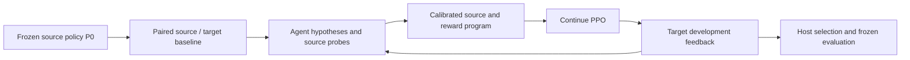

# DynamicsAdapt

**An agent diagnoses dynamics differences, reconstructs them in a source simulator,
and continues reinforcement learning to recover task performance.**

DynamicsAdapt builds on the Agent execution and isolation infrastructure of
EmbodiedEvo. The current case study transfers a cube-to-plate neural policy from
the nominal source to a fixed, hidden target in RoboDojo/Isaac Sim.
The agent chooses source physics parameters, writes reward programs, and requests
PPO training. Registered neural networks perform every formal robot rollout.



> **Status (2026-11-11).** The project is being migrated to a general harness in
> which the Agent revises the source world model and PPO continues on 512 GPU
> replicas. See [PLAN.md](PLAN.md) and [the harness spec](docs/HARNESS_SPEC.md).
> The description below is the legacy FrictionAgent implementation.

The experiment keeps target parameters private, preserves failed attempts, and
reports task recovery separately from the evidence for a diagnosis. It uses one
fixed scene, four development episodes, and a final evaluation of 10 deterministic
plus 20 stochastic episodes. Acceptance requires at least 27 strict successes.
There is no matched control branch in this case study. See the
[research protocol](docs/PROTOCOL.md) for the precise scope and success rules.

## Start here

Use Linux, Python 3.11+, and an editable source checkout. Follow
[installation](docs/INSTALL.md) for the host/RL environments, provisioned simulator
image and assets, and thin Agent image. Configure the model using
[Codex API setup](docs/CODEX_API.md). Runtime files, weights and credentials are
local prerequisites and are not distributed with the source.

After setting `p0.policy`, `p0.demos`, image names and model settings in a local copy
of [the experiment configuration](tasks/DynamicsAdapt/config.example.json):

```bash
RUN_DIR="runs/$(date +%Y%m%d%H%M)_dynamicsadapt"
.venv-rl/bin/dynamicsadapt run --config /path/to/experiment.json \
  --run-dir "$RUN_DIR" --gpu 0
.venv-rl/bin/dynamicsadapt evaluate --run-dir "$RUN_DIR" --gpu 0
.venv-rl/bin/dynamicsadapt summarize --run-dir "$RUN_DIR"
```

`python -m orchestrator` exposes the same commands. [Running experiments](docs/RUNNING.md)
also covers optional P0 demonstration collection/behavior cloning, smoke runs and
the separate host-only trainability check.

CPU validation, when the local test suite is available (tests are excluded from Git):

```bash
.venv-rl/bin/python -m unittest discover -s tests -v
```

GPU simulation, container builds and model calls require separate resources; CPU
tests do not establish physical correctness or policy performance.

## Code map

| Path | Role |
|---|---|
| `orchestrator/experiment.py`, `experiment_service.py`, `experiment_jobs.py` | Experiment lifecycle, restricted Agent requests, retained rollout/training jobs |
| `orchestrator/launch_agent.py` | Isolated CLI Agent and private temporary home |
| `orchestrator/p0.py` | Optional source demonstrations, behavior cloning and P0 evaluation |
| `integrations/friction_rl/` | Policy, PPO, reward sandbox, episode execution and simulator transport support |
| `simulators/` | RoboDojo task, physics, native scoring and raw capture |
| `tasks/DynamicsAdapt/` | Experiment configurations, public Agent workspace and host-only smoke/oracle helpers |
| `docker/agent/`, `configs/` | Agent image definition and configuration templates |

## Provenance and evidence

The historical run `202611041916_fa_run` recorded P0 at **0/30** and the selected
N002 policy at **30/30** strict target successes. These are retained historical
results for this single scene, not a new validation of the refactored code or
evidence of generalization to other layouts or real robots.

[Source history](docs/SOURCE.md) describes the EmbodiedEvo contribution, removed
historical experiment branches and the unchanged source manifest.
[Third-party notices](THIRD_PARTY_NOTICES.md) describe upstream dependencies and
the historical recipe license. No project-wide license has been selected.
